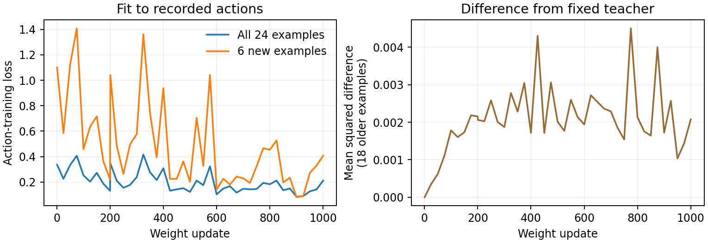
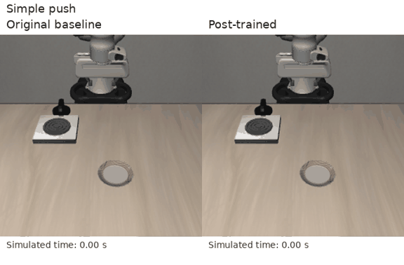
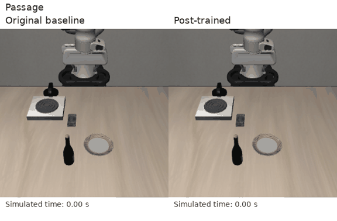
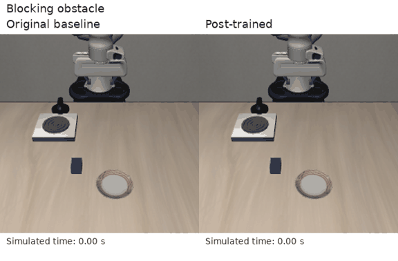
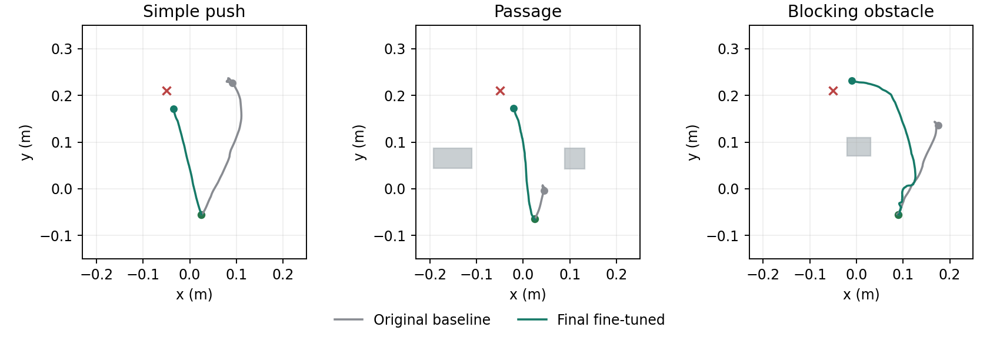

# Learning a plate push from video

I chose a simple LIBERO task: **push the plate to the front of the stove**. It lets me inspect the approach, contact and final position within a short project. I added a blocking obstacle and passages to test the same skill under layout changes.

The main comparison is **the original public SmolVLA checkpoint versus my final fine-tuned policy**. A small visual forward predictor is an optional extra. Intermediate checkpoints are kept outside the main comparison.

## From recording to robot data

I recorded four phone videos: normal pushes, losing contact and trying again, a single obstacle, and passages. ArUco markers identify the hand, plate, table, stove and reset periods. I used a checkerboard for camera calibration and measured the marker sizes and plate diameter.

I removed resets and the return-to-start motion, then mapped measured paths into Panda actions. Some direct transfers failed. The final library therefore also includes simulation examples and completed trajectories, with each source labelled separately. It contains **13 robot demonstrations, 19 continuous segments and 3,990 accepted action labels**. Older records provide replay during training.

[Recording and demonstration examples](docs/DATA.md) · [Printable markers](docs/real-video-markers-A4.pdf)

## Model and training

| Component | What I trained |
|---|---|
| Vision and language backbone | Kept fixed; reads images and the instruction |
| Action expert and its input/output mappings | Trained; produces robot commands |
| Teacher: a fixed copy of the starting policy | Training reference for older examples |
| Optional forward predictor (small world model) | Fixed image encoder; fitted feature compression and linear prediction |

The final stage uses **1,000 weight updates**. Each update uses a batch of **24 training examples: six from the new library and eighteen from older data**. Reusing older examples is called replay. The learning rate, 0.000001, controls the size of weight changes.

One example (called a “context” in the training code) contains two camera images, the robot state, the instruction and up to 50 following actions. **Six examples do not mean six videos**; several moments can come from one recording. I train the policy to follow the recorded actions and stay close to the fixed teacher on older examples. [Method and term explanations](docs/METHOD.md) · [Model history and data sources](docs/MODEL.md)

**Left:** action-training loss for all 24 examples (blue) and the six new examples alone (orange). Lower means a better fit to those sampled demonstrations. **Right:** average squared difference from the fixed teacher on the eighteen older examples. Zero means identical predictions on that batch; a rise means the policy is moving away from the teacher.

The horizontal axis counts weight updates. These losses have no centimetre or percentage units. The batches change, so the curves fluctuate. They do not measure task success or prove that old skills are preserved; I check those with robot runs.

## Evaluation

The policy sees two colour camera views (RGB), the robot's eight state values and the same plate instruction in every layout. It receives no simulator object positions. I measure target-region arrival, actual obstacle contact, simulated time, total travelled path and contact breaks. Centre error is the plate’s distance from the target centre. Stopped drift is its extra movement after a neutral hold command. Contact breaks count interruptions in robot–plate contact. These are extra diagnostics; the full success rule and units are in the [results](docs/RESULTS.md).

The fixed final policy completes the familiar simple push, blocking obstacle and passage controls. Original-baseline comparisons use the same initial observations and geometry. New layout checks are reported separately, including failures.

| Task | Original baseline | Post-trained |
|---|---:|---:|
| Simple push | Fail | Pass |
| Passage | Fail | Pass |
| Blocking obstacle | Fail | Pass |

**Three matched development controls: 0/3 → 3/3.** One run per case; same initial observations and physics.

### Simple push

### Passage

### Blocking obstacle

The GIFs play here; click for full MP4. Each side shows its own simulated time. After a recording ends, its last frame is held for display.

I also completed **seven layout checks**. The final policy succeeds at the shifted and diagonal passages, where the matched original baseline fails. The round obstacle gives near-arrival with contact; left start, forward-right start, shifted obstacle and the moved stove fail. The moved-stove case has no baseline run. [All seven results and videos](docs/NEW-LAYOUTS.md) are reported separately.

Some extra tests execute five commands before looking at a new image; others execute ten. Each baseline–final pair uses the same setting. I keep these protocols separate rather than pooling their success rates.

These top-down paths follow the plate centre across recorded simulation steps. The axes are table coordinates in metres. Path length sums the travelled segments, including turns; it is not the straight-line start-to-finish distance.

[Baseline versus final results](docs/RESULTS.md) · [New layouts and predictor tests](docs/NEW-LAYOUTS.md) · [All control metrics](results/metrics.csv)

The recorded horizontal passage still fails: less obstacle contact does not mean reaching the goal. Larger starting changes also expose missed approaches. The predictor ranks four learned action proposals; it is not a collision guarantee. Better approach and contact-recovery data are future work. A [small native-task check](docs/RETENTION.md) retains the stove task and succeeds at opening a drawer; it does not establish retention of every pretrained skill.

## Run

[Setup, model download, training and evaluation commands](docs/RUNNING.md). Weights and training records use Git LFS. [Research notes](docs/RESEARCH.md) describe what I used from SmolVLA, Learning without Forgetting, DINOv2 and DINO-WM.
