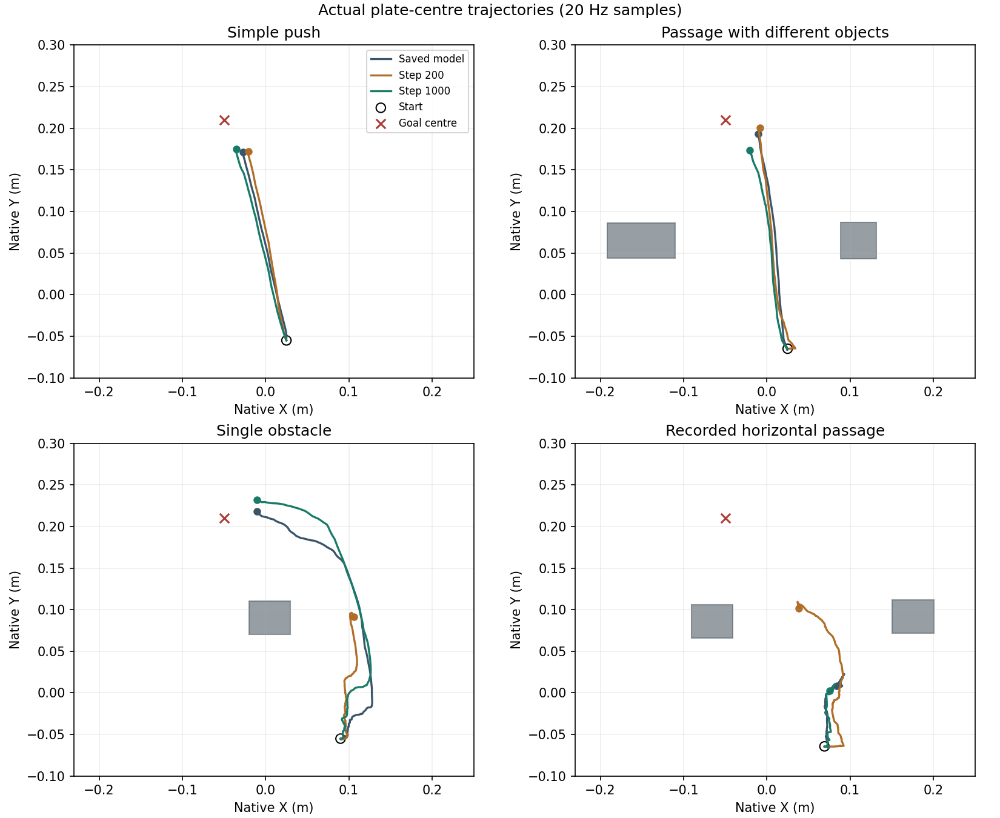

# Learning a plate push from video

I chose a plate-pushing task from LIBERO. The robot moves a plate to the front of a stove. It is simple enough to inspect contact, missed approaches and changes in the starting position. I also added a single obstacle and two objects forming a passage.

I used SmolVLA because it takes camera images, a language instruction and the robot state, and predicts actions. The instruction is **“push the plate to the front of the stove”** in all plate scenarios.

## Data

I recorded four phone videos: normal pushes, reapproaching after losing contact, an obstacle, and passages. Printed ArUco markers identify the hand, plate, table, stove and reset periods. A checkerboard provides camera calibration. The plate is about 18 cm wide; measured marker sizes set the scale.

I split the recording at resets, removed the return-to-start motion, and mapped the measured paths into Panda movements. Retargeting was not always successful. The final library also includes simulation examples and completed trajectories. These are recorded separately in the data manifest; they are not all direct transfers from my videos.

The new library contains **13 robot demonstrations, 19 continuous segments and 3,990 accepted action labels**. Older demonstrations provide replay during training. Demonstration videos show the data, not the learned policy.

## Model and training

| Part | What I changed |
|---|---|
| SmolVLA vision-language backbone | Frozen: 489 tensors |
| Action expert and projections | Trained: 299 tensors |
| Previous successful policy | Frozen teacher during training only |
| Optional visual forward predictor | Frozen DINOv2 features, fitted PCA and ridge predictor |

The final update starts from my previous successful checkpoint, **not directly from the public checkpoint**. I ran 1,000 updates with batch size 24, learning rate 0.000001, six new-data contexts and eighteen replay contexts. The loss combines supervised flow matching with a teacher velocity-matching loss on replay. This follows the idea of Learning without Forgetting; it does not guarantee retention.

At inference the VLA uses two RGB views, eight robot-state values and language. It receives no simulator object positions. The optional predictor estimates five-command outcomes and ranks four VLA proposals. It is a small forward predictor, not a newly trained DINO backbone or a full video world model. No successful RL improvement is claimed.

## Verified controls

These four layouts were already used during development. Each has one run per model. They are **not unseen generalization tests**.

| Plate task | Previous policy | Final policy |
|---|---:|---:|
| Simple push | Pass | Pass |
| Passage with different objects | Pass | Pass |
| Single blocking obstacle | Pass | Pass |
| Recorded horizontal passage | Fail | Fail |

Success requires target-region arrival (native goal or the fixed 50 mm tolerance), the required passage crossing, and no added-obstacle contact. Distance alone does not determine failure. I also report simulated time, total travelled path, contact and stopped drift. Simulator state is used for scoring, not policy input.

[Simple push](media/final-simple.mp4) · [Passage](media/final-passage.mp4) · [Blocking obstacle](media/final-obstacle.mp4) · [Failed passage](media/final-horizontal-passage.mp4)

The three previous pushing successes remain successful. This is a small retention check, **not evidence that all pretrained LIBERO skills are preserved**. In the failed passage, obstacle contacts decreased but the plate still stopped far from the goal. Better contact and approach data remain useful future work.

[All control metrics](results/metrics.csv) · [Model and data details](docs/METHOD.md) · [Run instructions](docs/RUNNING.md)

## References

[SmolVLA training guide](https://huggingface.co/docs/lerobot/main/smolvla), [LIBERO](https://github.com/Lifelong-Robot-Learning/LIBERO), [Learning without Forgetting](https://arxiv.org/abs/1606.09282), [DINOv2](https://arxiv.org/abs/2304.07193).
