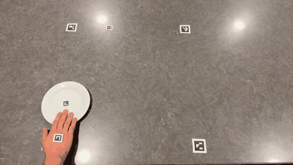
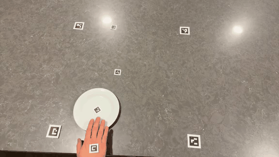
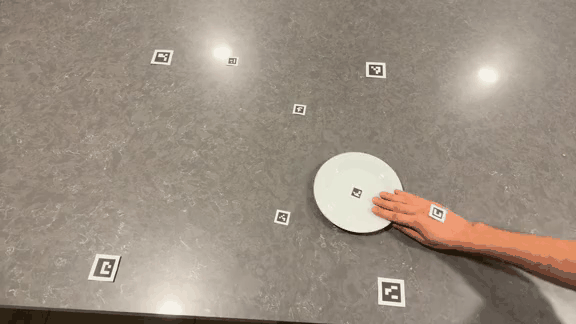
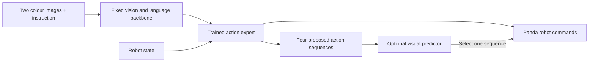
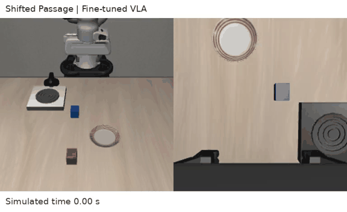
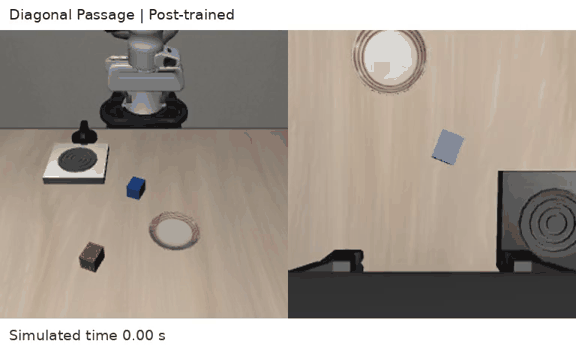
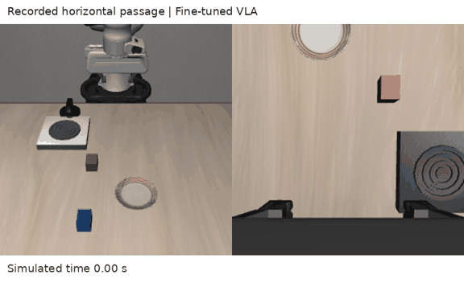

# Learning a plate push from video

I chose a simple LIBERO task: **push the plate to the front of the stove**. It lets me inspect the approach, contact and final position within a short project. I added a blocking obstacle and passages to test the same skill under layout changes.

The main comparison is **the original public SmolVLA checkpoint versus my final fine-tuned policy**. A small visual forward predictor is an optional extra. Intermediate checkpoints are kept outside the main comparison.

## From recording to robot data

I recorded four phone videos: normal pushes, losing contact and trying again, a single obstacle, and passages. ArUco markers identify the hand, plate, table, stove and reset periods. I used a checkerboard for camera calibration and measured the marker sizes and plate diameter.

I removed resets and the return-to-start motion, then mapped measured paths into Panda actions. Some direct transfers failed. The final library therefore also includes simulation examples and completed trajectories, with each source labelled separately. It contains **13 robot demonstrations, 19 continuous segments and 3,990 accepted action labels**. Older records provide replay during training.

[Recording and demonstration examples](docs/DATA.md) · [Four original phone videos](recordings/README.md) · [Printable markers](docs/real-video-markers-A4.pdf)

### Short clips from my recordings

<table>
  <tr>
    <th width="33%">Ordinary push</th>
    <th width="33%">Obstacle recording</th>
    <th width="33%">Passage recording</th>
  </tr>
  <tr>
    <td width="33%" align="center" valign="top"><a href="media/phone-push-landscape.mp4"></a></td>
    <td width="33%" align="center" valign="top"><a href="media/phone-obstacle-landscape.mp4"></a></td>
    <td width="33%" align="center" valign="top"><a href="media/phone-passage-landscape.mp4"></a></td>
  </tr>
</table>

I varied the plate start and push direction instead of repeating one route. I also recorded deliberate contact loss and another approach, to provide examples of recovery. Obstacle and passage recordings add route changes while keeping the same goal. These are the intended skills in the data, not a claim that the final policy learned every variation.

Markers make the hand, plate and layout measurable. Table markers set the coordinate frame and scale; the stove marker anchors the goal; the reset marker separates takes so return motions are not treated as pushes. The paper obstacle marker represents the intended obstacle location. I check the transferred motion in Panda before accepting training labels. Preview colours are converted for viewing; original videos stay unchanged.

## Model and training

| Component | What I trained |
|---|---|
| Vision and language backbone | Kept fixed; reads images and the instruction |
| Action expert and its input/output mappings | Trained; produces robot commands |
| Teacher: a fixed copy of the starting policy | Training reference for older examples |
| Optional forward predictor (small world model) | Fixed image encoder; fitted feature compression and linear prediction |



The normal policy sends the action expert’s commands to Panda. The optional predictor also reads current/past images and robot state, through its own fixed DINOv2 encoder, to rank the VLA proposals. It does not change the VLA weights during inference. The teacher is a fixed copy of the starting policy, used only during training to discourage changes on older examples; it is absent from both inference paths.

The final stage uses **1,000 weight updates**. Each update uses a batch of **24 training examples: six from the new library and eighteen from older data**. Reusing older examples is called replay. The learning rate, 0.000001, controls the size of weight changes.

One example (called a “context” in the training code) contains two camera images, the robot state, the instruction and up to 50 following actions. **Six examples do not mean six videos**; several moments can come from one recording. I train the policy to follow the recorded actions and stay close to the fixed teacher on older examples. [Method and term explanations](docs/METHOD.md) · [Model history and data sources](docs/MODEL.md)


**Left:** action-training loss for all 24 examples (blue) and the six new examples alone (orange). Lower means a better fit to those sampled demonstrations. **Right:** average squared difference from the fixed teacher on the eighteen older examples. Zero means identical predictions on that batch; a rise means the policy is moving away from the teacher.

The horizontal axis counts weight updates. These losses have no centimetre or percentage units. The batches change, so the curves fluctuate. They do not measure task success or prove that old skills are preserved; I check those with robot runs.

## Evaluation

The policy sees two colour camera views (RGB), the robot's eight state values and the same plate instruction in every pushing layout. It receives no simulator object positions. I measure target-region arrival, actual obstacle contact, simulated time, total travelled path and contact breaks. Centre error is the plate’s distance from the target centre. Stopped drift is its extra movement after a neutral hold command. Contact breaks count interruptions in robot–plate contact. These are extra diagnostics; the full success rule and units are in the [results](docs/RESULTS.md).

The fixed final policy completes the familiar simple push, blocking obstacle and passage controls. Original-baseline comparisons use the same initial observations and geometry. New layout checks are reported separately, including failures.

| Task | Original baseline | Post-trained |
|---|---:|---:|
| Simple push | Fail | Pass |
| Passage | Fail | Pass |
| Blocking obstacle | Fail | Pass |

**Three matched development controls: 0/3 → 3/3.** One run per case; same initial observations and physics.

### Control quality: baseline → post-trained

Each cell shows **original baseline → final policy**, from the same three paired runs.

| Task | Centre error (mm) | Sim. time (s) | Gripper path (cm) | Plate path (cm) | Contact breaks | Obstacle contact samples: plate / robot |
|---|---:|---:|---:|---:|---:|---|
| Simple push | 142.3 → 38.4 | 22.5 → 6.2 | 161.0 → 76.3 | 34.3 → 23.5 | 3 → 0 | 0 / 0 → 0 / 0 |
| Passage | 234.6 → 47.3 | 22.5 → 7.6 | 162.4 → 75.3 | 10.7 → 24.6 | 2 → 0 | 1042 / 2368 → 0 / 0 |
| Blocking obstacle | 236.5 → 45.4 | 22.5 → 19.1 | 150.9 → 109.3 | 23.4 → 38.5 | 1 → 1 | 0 / 83 → 0 / 0 |

Paths sum actual movements, including turns. Contact breaks mean lost robot–plate contact; obstacle samples count physics steps in contact, not individual impacts. The failed baselines use the full 22.5 s limit; successful runs stop at arrival. These are single-run measurements, not average speed or efficiency claims.

Stopped drift is also recorded: baseline → final is 0.0 → 10.5 mm (simple), 0.0 → 0.9 mm (passage), and 0.0 → 0.6 mm (obstacle). A failed stationary plate can have zero drift, so lower drift alone does not mean a better push. [Raw measurements and metric definitions](docs/RESULTS.md).

### Simple push

[](media/compare-simple.mp4)

### Passage

[](media/compare-passage.mp4)

### Blocking obstacle

[](media/compare-obstacle.mp4)

The GIFs play here; click for full MP4. Each side shows its own simulated time. After a recording ends, its last frame is held for display.

### Paths for the three main comparisons

These plots belong only to **Simple push, Passage and Blocking obstacle** in the main baseline–final table. They do not show the additional passage layouts or the video-based failure.


These top-down paths follow the plate centre across recorded simulation steps. Grey lines are the original baseline, green lines the final policy; the red cross is the target centre and shaded shapes mark obstacles. The axes are table coordinates in metres. Path length sums the travelled segments, including turns; it is not the straight-line start-to-finish distance.

[Baseline versus final results](docs/RESULTS.md) · [New layouts and predictor tests](docs/NEW-LAYOUTS.md) · [All control metrics](results/metrics.csv)

### Additional layouts

I also completed **seven final-policy layout checks**, with matched original-baseline runs for the first six. The final policy succeeds at the passage at a new position and the diagonal passage, where the matched original baseline fails. The round obstacle gives near-arrival with contact; left start, forward-right start, shifted obstacle and the moved stove fail. The moved-stove case has no baseline run. [All seven results and videos](docs/NEW-LAYOUTS.md) are reported separately.

Some extra tests execute five commands before looking at a new image; others execute ten. Each baseline–final pair uses the same setting. I keep these protocols separate rather than pooling their success rates.

### Two layout successes and one failure

**Passage at a new position — pass.** The original baseline fails on the same layout.

[](media/test-4-fine.mp4)

**Diagonal passage — pass.** The original baseline fails on the same layout.

[](media/layout-5-fine.mp4)

**Video-based passage — fail.** The policy avoids added-obstacle contact but loses useful plate contact and does not cross the passage.

[](media/final-horizontal-passage.mp4)

The video-based passage still fails: less obstacle contact does not mean reaching the goal. Larger starting changes also expose missed approaches. The predictor ranks four learned action proposals. In matched tests on both the passage at a new position and the simple push, it turns a VLA success into a failure. I keep these [negative predictor results](docs/NEW-LAYOUTS.md#simple-push-with-and-without-the-predictor) separate from the main comparison. Better approach and contact-recovery data are future work. A [small native-task check](docs/RETENTION.md) retains the stove task and succeeds at opening a drawer; it does not establish retention of every pretrained skill.

## Run

[Computer, package versions, setup, training and evaluation commands](docs/RUNNING.md). Weights and training records use Git LFS. [Research notes](docs/RESEARCH.md) describe what I used from SmolVLA, Learning without Forgetting, DINOv2 and DINO-WM.

## Repository map

```text
Humanoid_VLA/
├── README.md          # Project summary, comparisons and videos
├── docs/              # Method, data sources, results and run instructions
├── scripts/           # Prepare models, train, evaluate and plot
├── src/               # Policy runtime, training loss and simulator helpers
├── configs/           # Fixed test layouts and model settings
├── requirements/      # Package versions for the three environments
├── recordings/        # Four original phone videos (Git LFS)
├── training_data/     # Training records and batch schedule (Git LFS)
├── weights/           # Final action expert, teacher and optional predictor
├── media/             # Robot demonstrations and inference videos
├── figures/           # Loss and trajectory plots
├── results/           # Measurements, plans and verification records
├── method_source/     # Archived data-preparation entrypoints and limitations
└── third_party/       # LIBERO runtime source and license
```

Start with [run instructions](docs/RUNNING.md) to reproduce the exported-data training and evaluation. [Data notes](docs/DATA.md) distinguish personal-video transfers, simulation examples and completed paths.
