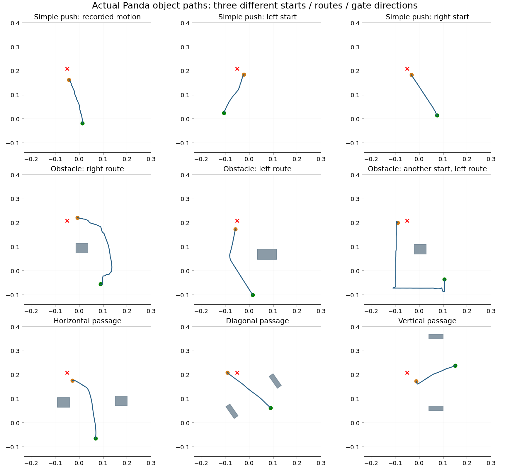

# Data notes

The path figure below shows robot demonstrations used for training, not learned-policy rollouts. Green is the start, orange the finish, red the target centre. Grey shapes are obstacles.

There are four original phone files and thirteen completed Panda replays. These counts have different meanings. The library combines measured paths, simulation completion and older simulation sources. Nineteen contiguous accepted ranges contain 3,990 labels. Unsafe ranges are excluded; future chunks never cross the gaps.

The source manifest records each origin, accepted action ranges and hashes. Original source files are preserved locally. The repository provides representative videos; full original phone footage is not needed to view results.

Printed markers: [table/hand/plate/reset/stove](real-video-markers-A4.pdf), [hand and obstacle page](obstacle-and-passage-markers-A4.pdf). Print at actual size. Measure the black square, excluding the white border.

[Phone recording: ordinary push](../media/phone-push-landscape.mp4) → [Panda training demonstration](../media/demonstration-simple-centre.mp4). The phone preview is tone-mapped for viewing; original source bytes and measured tracking remain preserved. The simulation replay includes the robot approach and is not a learned-policy rollout.

[All four original phone recordings](../recordings/README.md) are stored with Git LFS. The short [ordinary push preview](../media/phone-push-landscape.mp4) uses a separate viewing colour conversion; the original MOV files are unchanged.
