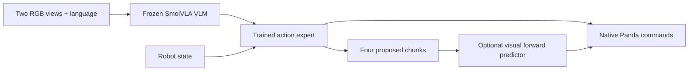

# Model identities

The public checkpoint is `HuggingFaceVLA/smolvla_libero` at revision `6721902bc4d61e50a3bfdb11dfb4cb626f05d102`. Its model file SHA-256 is `71d9563c8295284acba8fc2d5c19de000d6fe9ba58a406832af7ef3d221ed52f`. Its exact pretraining task coverage is not inferred from the model name.

The previous trained expert SHA-256 is `3008e1c210b301dc820a18c6552a5a66ba36fa6ef0873f55da40cd4e872a103f`. The final expert SHA-256 is `f0007e82c7b19b2a125def94b3bf9fce63e5c5e5357cf5c781db789245161d16`. The predictor SHA-256 is `341c9f913a2c5548e4274343aaedf5eceac758d338dc51a8bbd109cec14087f0`.

All 489 frozen backbone tensors were checked against the public weights, including dtype. They are identical. The expert file replaces all 299 trainable tensors once when loading; it is not an extra inference controller. Final policy processors and tokenizer files are included unchanged in `configs/policy/`.

The report fixes the final 1,000-update checkpoint. The previous trained policy remains a separate preserved comparator. The historical study adoption flag is false because those four controls showed no new task-success gain. That archived flag is kept in the raw results; choosing the final checkpoint for this report does not establish that it is better on every task.

The optional branch uses current/past images, current/past robot state and proposed commands. It does not receive simulator object positions or a collision flag. Only the flow expert was updated in the last 1,000 steps; the predictor was not retrained for the personal-video stage.
