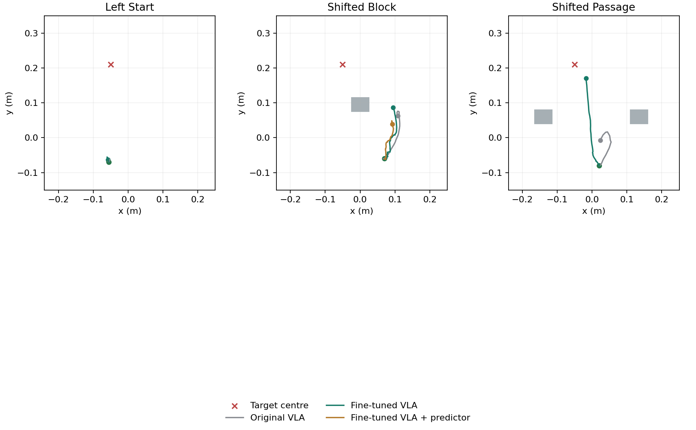

# New layout checks

These layouts were fixed before policy queries. Each completed run is listed below. They test local layout changes, not a full unseen-task benchmark. All methods use four proposals and five commands per planning step. The first proposal is used without the predictor.

| Layout | Original VLA | Fine-tuned VLA | Fine-tuned + predictor |
|---|---|---|---|
| Left Start | Fail ([video](../media/test-0-baseline.mp4)) | Fail ([video](../media/test-0-fine.mp4)) | Fail ([video](../media/test-0-world_model.mp4)) |
| Shifted Block | Fail ([video](../media/test-2-baseline.mp4)) | Fail ([video](../media/test-2-fine.mp4)) | Fail ([video](../media/test-2-world_model.mp4)) |
| Shifted Passage | Fail ([video](../media/test-4-baseline.mp4)) | Pass ([video](../media/test-4-fine.mp4)) | — |

A dash means not evaluated or not completed; it is not a failure or a success. The stopping time was fixed for the submission deadline.

[All metrics](../results/new-layouts.csv) · [Fixed plan](../results/new-layout-plan.json)

The shifted-left start is a failure of acquiring and maintaining useful contact. The predictor is not guaranteed to recover it. Native target success and collisions are retained separately in the CSV.
