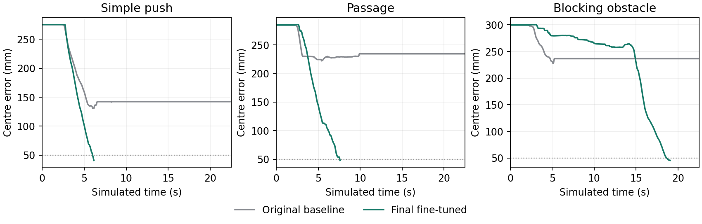

# Original baseline versus final policy

Same three familiar layouts, exact initial observations and physics. One rollout per method per layout. Both use the standard ten-command VLA queue; no world model or action correction. These layouts are development checks, not unseen generalization.

| Task | Original baseline | Final policy | Final error |
|---|---|---|---|
| Simple push | Fail ([video](../media/primary-0-baseline.mp4)) | Pass ([video](../media/primary-0-final.mp4)) | 38.4 mm |
| Passage | Fail ([video](../media/primary-1-baseline.mp4)) | Pass ([video](../media/primary-1-final.mp4)) | 47.3 mm |
| Blocking obstacle | Fail ([video](../media/primary-2-baseline.mp4)) | Pass ([video](../media/primary-2-final.mp4)) | 45.4 mm |

A failed baseline uses the full 22.5-second observation horizon. A successful policy stops earlier at the native goal; ten external hold commands then check that the result persists. The longer curve is not slower video playback.

[All primary metrics](../results/metrics.csv) · [New layouts and predictor](NEW-LAYOUTS.md)

Functional success uses native goal or the fixed 50 mm near-arrival criterion during all holds, with passage completion and no added-obstacle contact. Native goal is reported separately. The tolerance is a project criterion, not an official LIBERO score. Gripper travel sums consecutive measured 3D displacements; plate travel sums consecutive XY displacements. Contact samples are physics-substep pairs, not separate impacts. Efficiency is compared only where both methods succeed.

The video-based passage remains a failure: [final video](../media/final-horizontal-passage.mp4). Reduced obstacle contact alone does not complete the task. The baseline comparison measures the full post-trained pipeline; it does not isolate the causal effect of personal footage alone.

## Reading the measurements

| Measurement | Meaning |
|---|---|
| Goal error (mm) | Distance between the plate centre and the target centre. It is useful for comparison but does not decide success alone. |
| Simulated time (s) | Time advanced by the simulator, not real computer runtime or video playback time. |
| Plate / gripper travel (cm) | Sum of consecutive measured movements, including turns. Plate travel uses the table plane; gripper travel uses three dimensions. |
| Obstacle contact samples | Physics steps with a plate–obstacle or robot–obstacle contact. Several samples can belong to one sustained touch. |
| Contact breaks | Losses of robot–plate contact during the attempt. They help identify a missed push or recovery. |
| Stopped drift (mm) | Additional plate movement during the final neutral hold. It is a diagnostic, not a separate failure threshold here. |

The top-down plots show measured plate paths on the table in metres. The goal-error plots show centre distance over simulated seconds. A curve getting lower means the plate moves closer to the target; actual arrival and collision checks still determine the task result. Runs with different stopping times have different curve lengths.
